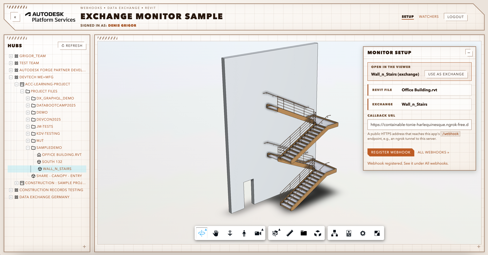
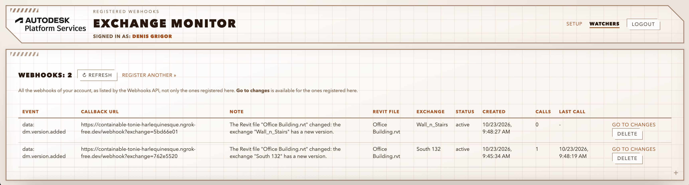
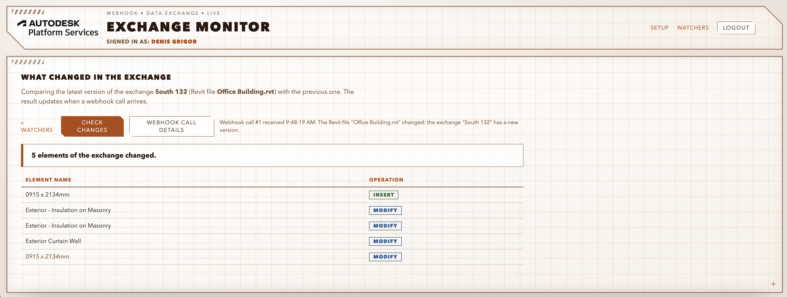

# APS Exchange Monitor (.NET)

[](https://dotnet.microsoft.com/)
[](http://opensource.org/licenses/MIT)

## Description

This sample illustrated how exchanges can be used to quickly identify if the needed parts of a design were changed or not.  
A webhook on the Revit file says little about *what* changed in the design. An exchange is a subset of the file (for example, the elements of one view) that updates itself when the file gets a new version. So the workflow is:

1. Create an exchange from a view with the elements you need (see the [Exchange Maker](https://github.com/autodesk-platform-services/aps-dx-graphql-exchange-maker-net) and [Exchange Creator](https://github.com/autodesk-platform-services/aps-dx-graphql-exchange-creator-net) samples).
2. Register a webhook on the exchange. When the Revit file gets a new version, the exchange updates and the webhook fires.
3. Query the exchange for the difference between its latest version and the previous one, using the [exchangeByVersions](https://aps.autodesk.com/en/docs/fdxgraph/v1/reference/queries/exchangebyversions/) call from Data Exchange GraphQL API. An **empty result** means the change did not touch your elements. Otherwise you see **which elements changed, and how** (`INSERT`, `MODIFY`, `DELETE`).

The app has four parts: a setup dialog over the Viewer (`/`), the endpoint that receives the callbacks (`/webhook`), the list of all webhooks of your account (`/watchers`), and the page that shows what changed (`/change`).


## Thumbnail

Setup: pick a Revit file and an exchange (the Viewer shows what you are about to pick), enter the callback URL and register the webhook.



Watchers: all the webhooks of the account, with the calls received, a **Go to changes** button and **Delete**.



Change: the elements of the exchange that changed in its latest version, shown when a webhook call arrives.



## Dependencies

- **[.NET 8 SDK](https://dotnet.microsoft.com/download)**
- **APS account**: [create an app](https://aps.autodesk.com/myapps) with the callback URL `http://localhost:8080/api/auth/callback`, with access to the Data Management, Data Exchange, Webhooks and Model Derivative (Viewer) APIs.
- The app's client ID added as a **custom integration** in your ACC account ([instructions](https://get-started.aps.autodesk.com/#provision-access-in-other-products)).
- A **Revit file in ACC and an exchange created from it**, in a project you can access.
- **[ngrok](https://ngrok.com/)** (or another tunnel): the Webhooks service needs a public HTTPS address for `/webhook`.

## Running locally

Everything the app does with APS needs a 3-legged token, so you sign in through the browser. The tokens are kept in cookies and refreshed automatically.

### 1. Set the APS credentials

```bash
export APS_CLIENT_ID="your client ID"
export APS_CLIENT_SECRET="your client secret"
export APS_CALLBACK_URL="http://localhost:8080/api/auth/callback"
```

### 2. Run the app

```bash
cd WebApp
dotnet run
```

### 3. Open a tunnel to the app

In another terminal:

```bash
ngrok http 8080
```

### 4. Register a webhook and watch the changes

1. Open [http://localhost:8080](http://localhost:8080) and log in.
2. In the tree, click a Revit file to look at its latest version in the Viewer. In the **Monitor setup** dialog, click **Use as Revit file**. Do the same with the exchange (**Use as exchange**).
3. Enter the callback URL, `https://<your ngrok domain>/webhook`, and click **Register webhook**.
4. Open **Watchers**, click **Go to changes** on the webhook, then upload a new version of the Revit file (or publish one from Revit).
5. After the exchange has synced (a few minutes), the callback arrives and the page shows what changed on its own. **Webhook call details** shows the call.

The default port is 8080, but you can change it in `WebApp/Properties/launchSettings.json`and it is important to match the port used in the callback url.

## Known issues

- **Sample only.** `/webhook`, `/api/events` and `/api/monitor/registrations` are not protected: anyone who knows your tunnel address can post to `/webhook` and read the payloads. Use a throwaway tunnel and stop it when you are done. The payloads are kept in memory (the last 500); the registrations are saved in `WebApp/monitor.json`.
- **The callback follows the exchange, not the file.** The exchange syncs a few minutes after the Revit file gets a new version (about 3.5 minutes in my tests), and the callback only comes then. A new version of the file that doesn't change the exchange triggers no callback.
- **Two exchanges in one folder need different callback URLs.** APS refuses a second webhook with the same event, folder and callback URL (`409 Failed to save duplicate webhooks scope`). The app adds `?exchange=<id>` to the callback URL to tell them apart; `/webhook` ignores it. 
- **Webhooks in other regions** (hubs outside the US) are not listed: the list is requested from the default region.
- **One page of results.** The query is sent without pagination, so a very large change may return only the first results.
- **Revit files and Revit cloud models** can be picked. Other files are hidden in the tree.

## Further reading
- [Exchange Maker](https://github.com/autodesk-platform-services/aps-dx-graphql-exchange-maker-net) and [Exchange Creator](https://github.com/autodesk-platform-services/aps-dx-graphql-exchange-creator-net): create the exchanges that this sample can monitor
- [Webhooks API](https://aps.autodesk.com/en/docs/webhooks/v1/developers_guide/overview/) and its [Data Management events](https://aps.autodesk.com/en/docs/webhooks/v1/reference/events/data_management_events/)
- [APS Data Exchange GraphQL tutorial](https://autodesk-platform-services.github.io/aps-dx-graphql-tutorial/)

## License

This sample is licensed under the terms of the [MIT License](LICENSE).
